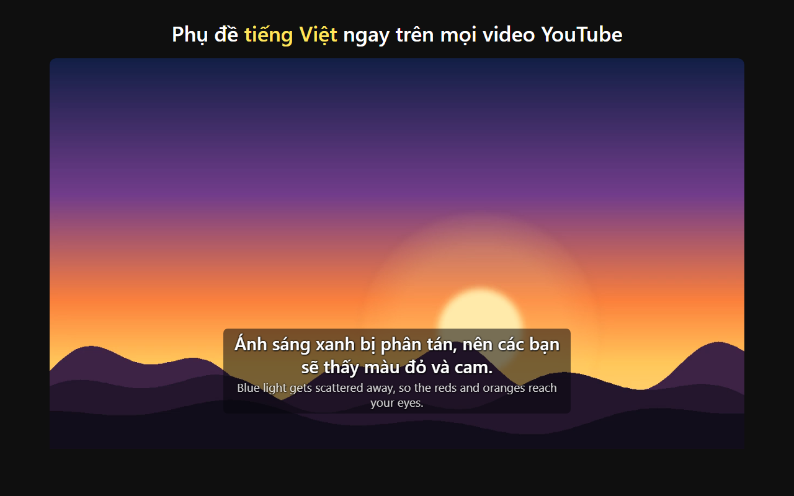

# livesub: phụ đề tiếng Việt cho YouTube

Extension Chrome dịch phụ đề tiếng Anh của video YouTube sang tiếng Việt và hiện ngay trên khung video, cả khi xem
toàn màn hình. Bạn chọn AI để dịch: OpenAI, Google Gemini, OpenRouter, hoặc model chạy trên máy (Ollama, LM Studio,
vLLM...), miễn là endpoint theo chuẩn OpenAI `/chat/completions`.



## Điểm khác so với dịch từng câu

- **Đọc thẳng chữ phụ đề của video**, không nhận dạng ảnh; dùng phụ đề do người làm, không có thì dùng phụ đề tự động.
- **Dịch trước cả video**, câu gần chỗ đang xem trước; tua tới đâu ưu tiên chỗ đó. Câu tiếng Việt có sẵn khi tới lúc
  hiện. Câu chưa dịch kịp hiện tiếng Anh mờ.
- **Ngữ cảnh** đi kèm từng câu:
  - 4 câu trước trong cùng đoạn hội thoại; im lặng hơn 12 giây thì bắt đầu đoạn mới.
  - Cách xưng hô. Video có người dẫn nói với người xem (vlog, hướng dẫn, review) tự xưng "mình", gọi "các bạn".
    Cuộc trò chuyện nhiều người thì không áp.
  - Thuật ngữ của bạn.
- **Tự học từ các câu đã dịch:** dịch xong cả bài, thuật ngữ nào được dịch một kiểu ở đa số câu (ví dụ "equations" =
  "phương trình") thì những câu dịch lệch được dịch lại theo kiểu đó.
- **Gợi ý thuật ngữ nổi bật** của video (từ lặp nhiều nhưng hiếm trong tiếng Anh). Bấm để thêm, rồi điền nghĩa. Có thể
  lưu cho một video hoặc cả kênh.
- **Sửa câu đang hiện:** câu sửa được giữ lại. Nếu bạn đổi cách xưng hô, app học cho cả video.
- **Cache:** xem lại video không tốn lượt gọi AI. Cache lưu 60 video gần nhất trên máy bạn.

## Cài đặt

1. Cài từ Chrome Web Store (sắp có), hoặc tải repo này rồi vào `chrome://extensions`, bật **Developer mode**, bấm
   **Load unpacked**, chọn thư mục repo.
2. Bấm biểu tượng livesub, mở **Kết nối AI**:
   - chọn một mẫu có sẵn hoặc nhập **Endpoint** (thường kết thúc bằng `/v1`), **API key** (nếu cần) và **Model**;
   - bấm **Lưu và kiểm tra**. Chrome hỏi quyền gọi đúng địa chỉ đó; app thử dịch một câu và báo kết quả.
3. Mở một video YouTube có phụ đề tiếng Anh.

| Dịch vụ | Endpoint | Model ví dụ |
|---|---|---|
| OpenAI | `https://api.openai.com/v1` | `gpt-4o-mini` |
| Google Gemini | `https://generativelanguage.googleapis.com/v1beta/openai` | `gemini-2.0-flash` |
| OpenRouter | `https://openrouter.ai/api/v1` | `openai/gpt-4o-mini` |
| Ollama (máy bạn) | `http://localhost:11434/v1` | `qwen2.5:7b` |
| LM Studio (máy bạn) | `http://localhost:1234/v1` | model đang mở |
| vLLM | `http://<máy>:8000/v1` | tên model khi chạy server |

**Kiểu prompt:**
- **Hy-MT:** dùng đúng định dạng của model Hy-MT2 đã fine-tune cho thoại game (bản dịch livesub).
- **Chat thường:** cho các model chat khác.
- **Tự chọn:** dùng Hy-MT khi tên model có "hymt" / "hy-mt", còn lại dùng Chat thường.

**Chi phí:** "Dịch trước: cả video" gọi AI một lần cho mỗi câu ngay khi mở video, thường vài trăm lượt. Với dịch vụ trả
tiền theo lượt, chọn "2 phút tới" để chỉ dịch quanh chỗ đang xem.

## Quyền riêng tư

Phụ đề của video đang xem và ngữ cảnh dịch chỉ được gửi tới endpoint bạn nhập. API key chỉ lưu trên máy bạn. Không có
thống kê, quảng cáo hay máy chủ trung gian. Chi tiết: [PRIVACY.md](PRIVACY.md).

## Phát triển

```bash
node test/core.test.js                       # logic lõi, đối chiếu với bản Python gốc (test/fixtures.json)
python test/serve.py 8091 .                  # rồi mở test/harness.html?video=...&srt=...&endpoint=...&model=...
python tools/build.py                        # dist/livesub-<version>.zip để tải lên Chrome Web Store
python tools/make_store_assets.py            # cảnh demo (tự vẽ), ảnh quảng bá 440x280
python tools/screenshots.py --endpoint ... --model ...   # ảnh chụp 1280x800 cho Store
```

- `src/core.js`: đọc phụ đề, chia câu, ngữ cảnh, prompt, thuật ngữ, tự học. Không dùng API trình duyệt, nên node test
  chạy được.
- `src/content.js`: engine dịch trong tab YouTube và phần hiển thị.
- `src/background.js`: phần duy nhất gọi endpoint.
- `src/page.js`: chạy trong trang để lấy bài phụ đề mà trình phát YouTube tải.
- `src/popup.*`: cài đặt.

Bảng tần suất từ tiếng Anh `src/words.js` lấy từ [wordfreq](https://github.com/rspeer/wordfreq), giấy phép CC BY-SA 4.0
(xem [NOTICE](NOTICE)).

---

## English

**livesub** translates the English captions of YouTube videos into Vietnamese with the AI endpoint you choose (any
OpenAI-compatible `/chat/completions`: OpenAI, Gemini, OpenRouter, Ollama, LM Studio, vLLM) and draws them over the
player.
- **Reads the caption track and translates the whole video ahead:** the lines next to the playback position go first.
- **Sends each line with its context:** previous lines, pronoun register, your glossary.
- **Learns how the translations render the video's key terms** and redoes the lines that disagree.
- **Keeps your corrections.**
- **Sends nothing anywhere except to your endpoint;** the API key stays on your device (see [PRIVACY.md](PRIVACY.md)).
